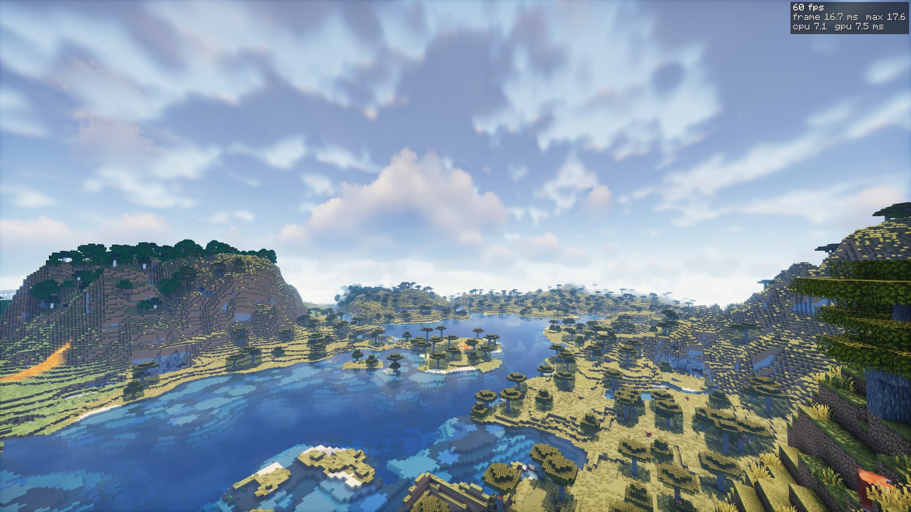
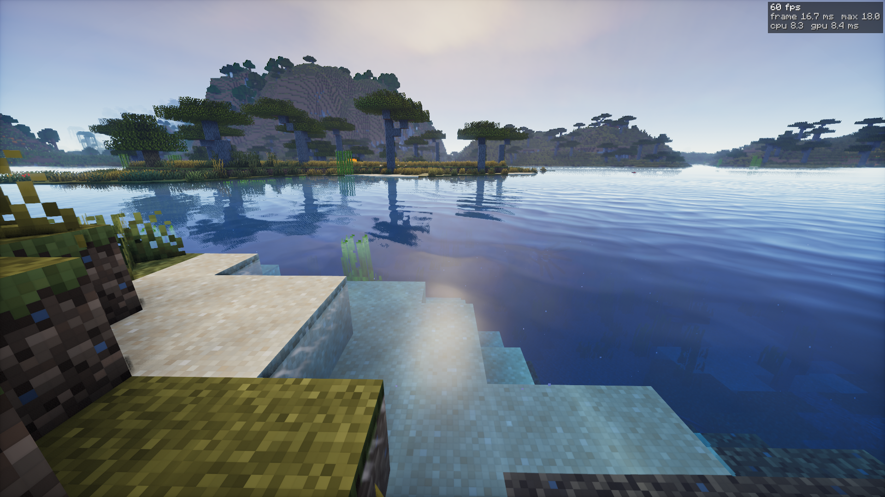
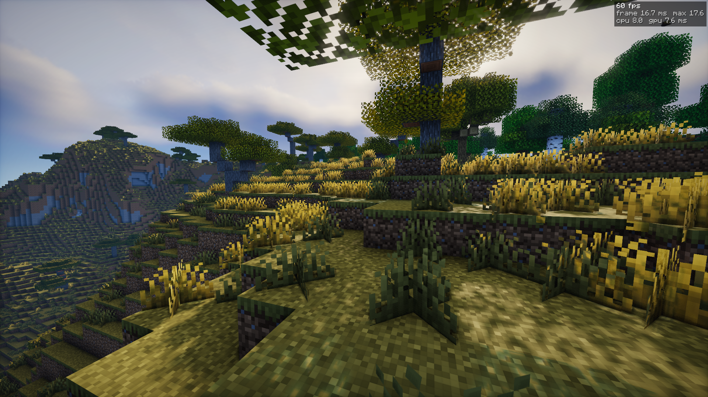
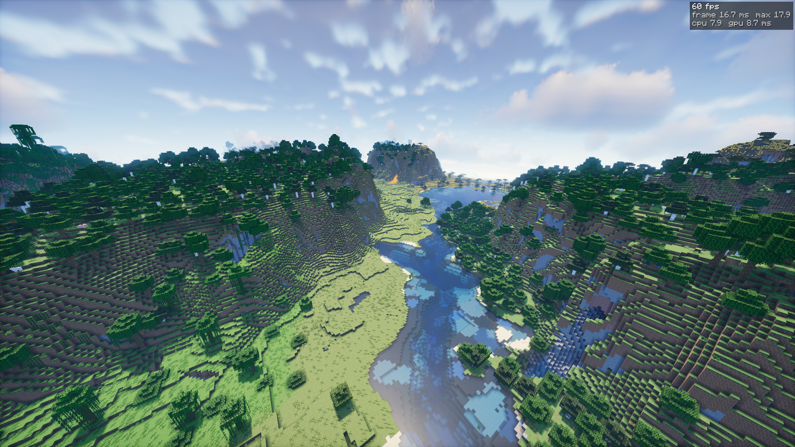

# Proton — Native Horizon Shader

Proton is a native WGSL shader pack for **Horizon** (Shader API `0.2`), based on **Photon** by SixthSurge and expanded with custom lighting, distant shadows, and post-processing.

|  |  |
| --- | --- |

## Highlights
- **Volumetric Clouds & Atmosphere** — 3D clouds with live terrain shadows, god rays, biome mist, rainbows, auroras, heat shimmer, and a starry night sky.
- **Indirect Light & Smooth Blocklight** — Soft bounced lighting in shade and caves, plus smooth coloured blocklight with no diamond falloff.
- **Far-Reaching Shadows** — Crisp shadow maps blended into distant terrain shadows, with grounded contact shading.
- **Water & Surfaces** — Animated ripples, depth-based colour absorption, reflections, rain-wet surfaces, and softly lit foliage.
- **Nether & End** — Atmospheric Nether haze with lava that cools where it touches solid blocks, plus a custom End sky and sun.
- **Post-Processing** — Temporal anti-aliasing, subtle sharpening, bloom, sun lens glow, and film-inspired colour grading.

## Requirements
- **Horizon** (latest, Shader API `0.2`)
- Works on any GPU supported by Horizon; hardware ray tracing is optional (used for RT reflections when enabled).

## Credits & License
- **SixthSurge (Benjamin Stott)** — Original author of [**Photon Shaders**](https://github.com/sixthsurge/photon), upon which Proton is based. Distributed under the [Photon Shaders License](LICENSE).
- **Eric Bruneton** — Precomputed atmospheric scattering LUT mapping.
